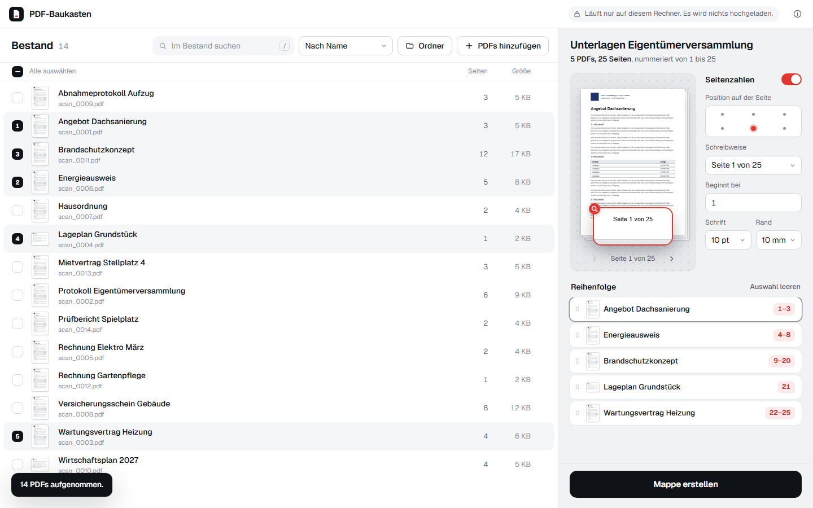

# PDF-Baukasten

Viele einzelne PDFs sammeln, benennen, per Häkchen zu einer neuen PDF zusammenstellen und durchgehend mit Seitenzahlen versehen. Alles läuft im Browser auf dem eigenen Rechner. Es wird nichts hochgeladen.



## Benutzen

1. [`PDF-Baukasten.html` herunterladen](https://github.com/danrbld/pdf-baukasten/releases/latest/download/PDF-Baukasten.html) (eine einzige Datei, etwa 2,4 MB).
2. Doppelklicken. Die Datei öffnet sich im Browser (Chrome, Edge, Firefox oder Safari).
3. PDFs oder einen ganzen Ordner hineinziehen, Namen vergeben, anhaken, Reihenfolge ziehen, Seitenzahlen einstellen, „Mappe erstellen“.

Keine Installation, kein Konto, kein Internet nötig.

## Was es kann

- Hunderte PDFs als Bestand, mit eigenen Namen, Suche und Sortierung. Getestet mit 300 PDFs und 796 Seiten.
- Neue Mappe per Häkchen, Reihenfolge per Ziehen.
- Seitenzahlen an sechs Positionen, fünf Schreibweisen („3“, „Seite 3“, „3 / 25“, „Seite 3 von 25“, „– 3 –“), Startnummer, Schriftgröße und Randabstand. Die Vorschau zeigt die echte Seite, die Lupe die Zahl in Originalgröße.
- Gedrehte Seiten und verschobene Seitenränder werden berücksichtigt.

## Gut zu wissen

- **Speicher:** Der Bestand bleibt in dem Browser gespeichert, in dem man ihn angelegt hat. Wer die Browserdaten löscht, löscht auch den Bestand. Die Original-PDFs bleiben unberührt.
- **Kein Netz:** Die Datei verbietet sich selbst jede Verbindung ins Internet (Content-Security-Policy `connect-src 'none'`). Das lässt sich in den Entwicklertools des Browsers nachprüfen.
- **Nicht unterstützt:** passwortgeschützte PDFs. Sie werden beim Hinzufügen gemeldet und übersprungen.
- **Safari:** Die kleinen Seitenbilder erscheinen dort etwas langsamer.

## Selbst bauen

```
npm install
node build.mjs            # schreibt PDF-Baukasten.html aus src/
node test/pruefung.mjs chromium   # oder firefox, webkit
```

`build.mjs` packt `src/`, pdf-lib, PDF.js und die Schrift in die eine HTML-Datei. Die Prüfung arbeitet nur mit erfundenen Test-PDFs.

## Lizenz

MIT, siehe [LICENSE](LICENSE). Enthaltene Bausteine: [pdf-lib](https://github.com/Hopding/pdf-lib) (MIT), [PDF.js](https://github.com/mozilla/pdf.js) (Apache 2.0), Schrift [Geist](https://github.com/vercel/geist-font) (SIL Open Font License). Die Lizenztexte stehen auch in der HTML-Datei.
